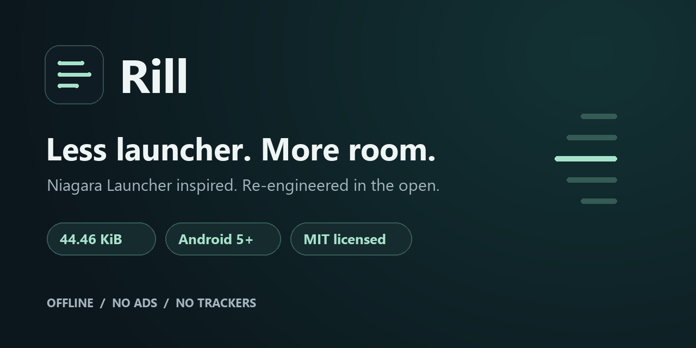

  

  
  
  
  

<h1 align="center">Rill · a tiny Android launcher</h1>

<strong>Niagara Launcher inspired. Re-engineered in the open. Under 45 KiB.</strong> Native Java. Your wallpaper. Your widgets. No ads, trackers or account.

  

<a href="docs/SCREENSHOTS.md">Screenshots</a> · <a href="docs/FEATURES.md">Features &amp; gestures</a> · <a href="docs/BUILDING.md">Build your own</a> · <a href="docs/NIAGARA-STUDY.md">Design study</a>

A calm, list-first home screen for older Android phones: favorites, one-handed alphabet navigation, prefix-first search and real Android widgets. Rill is an independent open-source project inspired by Niagara Launcher's public design documentation. It is not affiliated with Niagara Launcher and includes none of its source code or assets.

## Small by design

The included signed APK is **45,525 bytes: 44.46 KiB / 45.525 decimal KB**. “Under 45 KiB” refers to this APK, not runtime memory, installed storage or all future builds. It is not under 45,000 bytes. See the [checksum](dist/Rill-0.1.0.sha256.txt).

<table><tr>
<td align="center"> AMOLED black</td>
<td align="center"> Your wallpaper</td>
<td align="center"> Make it yours</td>
</tr></table>

Actual screenshots of the released APK on an Android 16 emulator. [Explore the full settings and features gallery](docs/SCREENSHOTS.md): every theme, all settings, widgets, clocks, search and icon styles. These are visual examples, not Android 6 performance measurements.

## Features

- Favorites, all apps, rename/hide/reorder and prefix-first search.
- Finger-following alphabet marker, inward rail curve and selected-letter top alignment.
- AMOLED black, transparent wallpaper, adjustable dimming and four gradient themes.
- Universal grayscale app icons, with original colors available in settings.
- Text shadows, compact search control and bottom navigation gradient.
- Native clock, date, optional second timezone and battery percentage.
- Real Android widgets and stacks on home and in app pop-ups.
- Optional local notification previews/actions, swipe dismissal and compatible media controls.
- Framework-only views, bounded icon caching and off-thread app/icon loading.

Grayscale covers all installed apps; it is not a custom outline icon pack. Widgets retain their provider's appearance and behavior. [Complete gesture and settings guide](docs/FEATURES.md).

## Try it

1. Download the APK and install it. Android may ask you to allow installation from that source.
2. Press Home and choose Rill, or select it in Android Settings → Home.
3. Open the bottom ellipsis for themes, widgets, wallpaper, dual clock and icons.
4. Tap apps to launch, long press to edit, slide the alphabet to navigate. Tap the magnifier or swipe up from the bottom controls to search.

Switch back using Android's Home settings. Rill does not set itself as default automatically. [Installation and troubleshooting](docs/BUILDING.md).

## Compatibility

| Item | Status |
| --- | --- |
| Declared minimum | Android 5 / API 21 |
| Primary intended target | Android 6 / API 23 |
| Physical installation | Xperia T2 Ultra running Android 6 |
| Emulator checks | Earlier UI/widget flows on Android 16; later polish partially checked |
| Full Android 5 runtime verification | Pending |
| Guaranteed every-phone compatibility or 60fps | Not claimed |

This passion project is a preview. OEM behavior and newer Android policies may affect installation, widgets and system bars. [Validation history and limits](docs/VALIDATION.md).

## Build

Requires Windows PowerShell, JDK 21, Android platform 34 and build tools 36.0.0. Run `build.ps1` with explicit `-Sdk` and `-Jdk` paths. No Gradle or external app dependencies. The build creates your own local signing key; the project's private key is never published. [Build instructions](docs/BUILDING.md).

## Documentation

- [Features and gestures](docs/FEATURES.md)
- [Screenshots and historical recording](docs/SCREENSHOTS.md)
- [Build and installation](docs/BUILDING.md)
- [Architecture](docs/ARCHITECTURE.md)
- [Validation and limitations](docs/VALIDATION.md)
- [In-depth Niagara design study](docs/NIAGARA-STUDY.md)
- [Privacy](PRIVACY.md), [changelog](CHANGELOG.md), [contributing](CONTRIBUTING.md)
- [Sharing and discoverability](docs/DISCOVERABILITY.md), [project icon and branding](docs/branding/README.md)

## License and credits

Original Rill code and documentation are [MIT licensed](LICENSE). Referenced products, third-party app icons, screenshot wallpaper artwork and widget UI retain their owners' rights. The study links to third-party documentation and does not relicense it. Personal wallpapers, signing keys and device logs are excluded.

## Looking for a lightweight Niagara Launcher alternative?

Rill explores a similar list-first approach in a small, open-source Android 5+ launcher. It is designed around Android 6 devices, AMOLED and transparent themes, offline customization and real widget support. If you searched for “Niagra launcher,” the project inspiration is **Niagara Launcher**; Rill remains an independent implementation.

Want to help? [Report a reproducible bug](https://github.com/grigsmediagroup-hash/rill-launcher/issues/new?template=bug_report.md), [read the contribution guide](CONTRIBUTING.md), or share the project link with someone who uses an older phone. A star helps you find Rill again.
