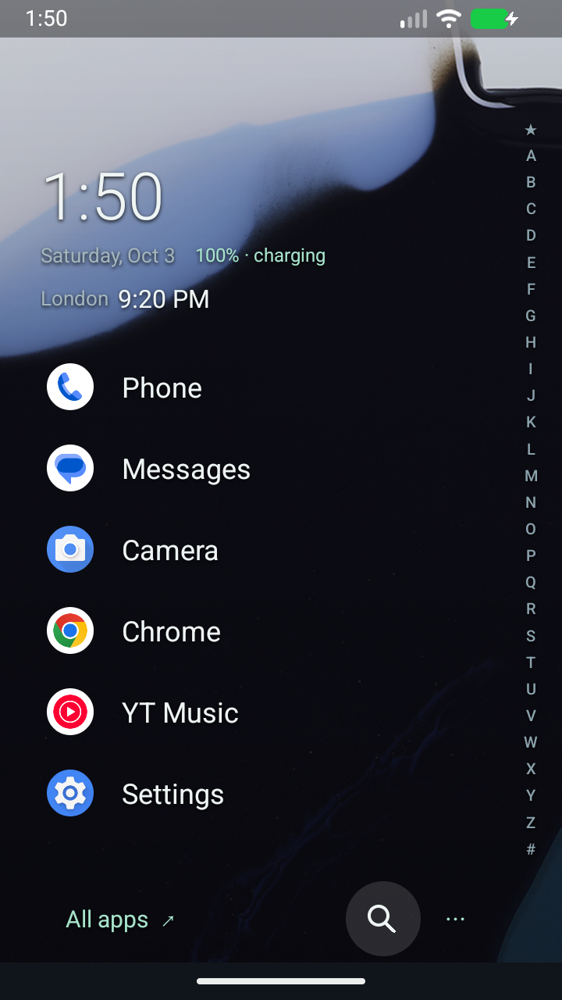
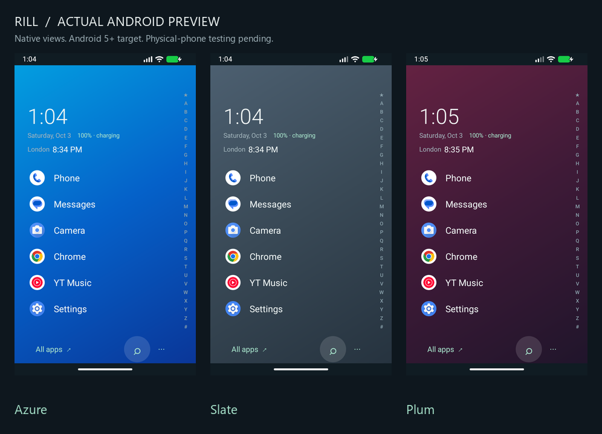
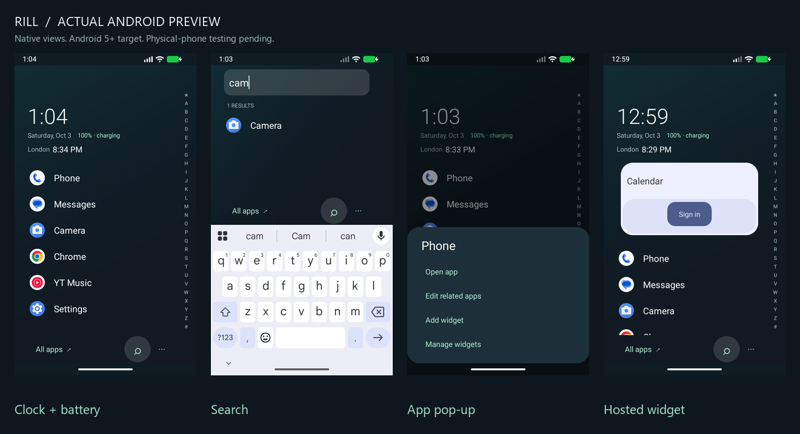

# Screenshots

Actual Android emulator captures from development, not mockups. They show several stages and predate the final universal grayscale mode, AMOLED option and transparent bottom navigation gradient. Third-party icons, wallpaper and widget contents retain their owners' rights. No personal device captures or notification content are included.

## Home and wallpaper

The current build extends the background behind the bottom bar with a gradient instead of the solid strip pictured here.

## Gradient themes

## Search, pop-ups and widgets

These older images show an earlier search control and colored icons. The current control is a compact drawn magnifier; icons are grayscale by default. Calendar sign-in belongs to the widget provider; Rill requires no account.

## Historical recording

[Watch the emulator walkthrough](media/walkthrough.mp4). This demonstrates earlier navigation/search/pop-up behavior; it is not a final-build performance benchmark.
