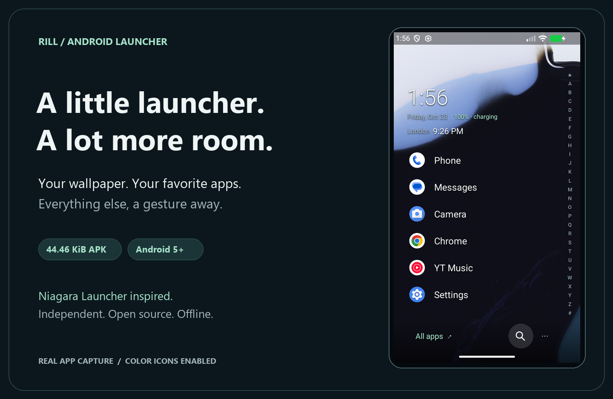
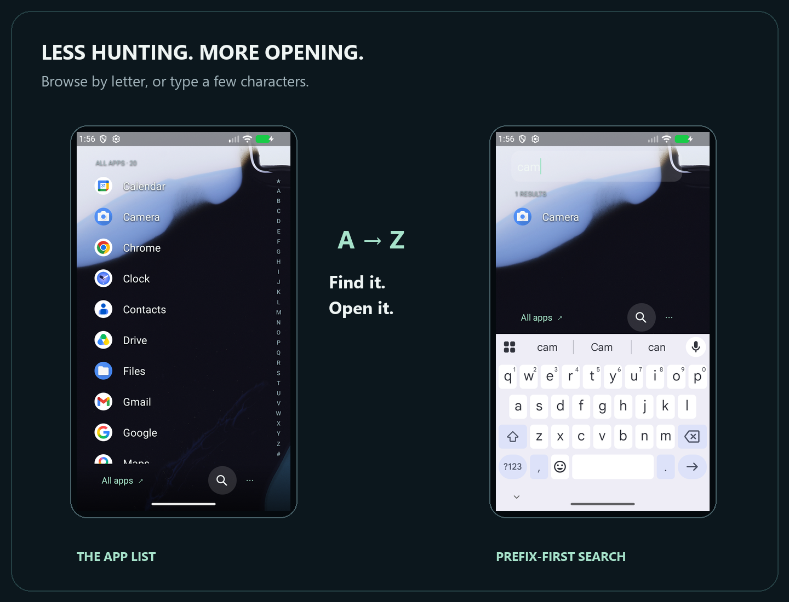
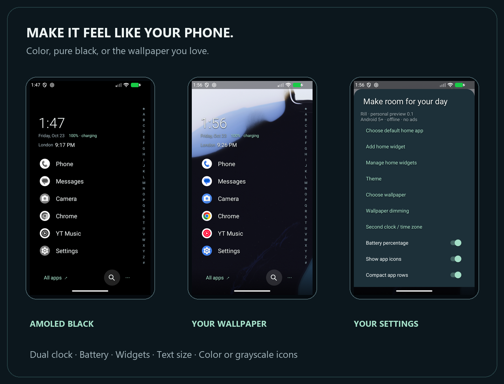
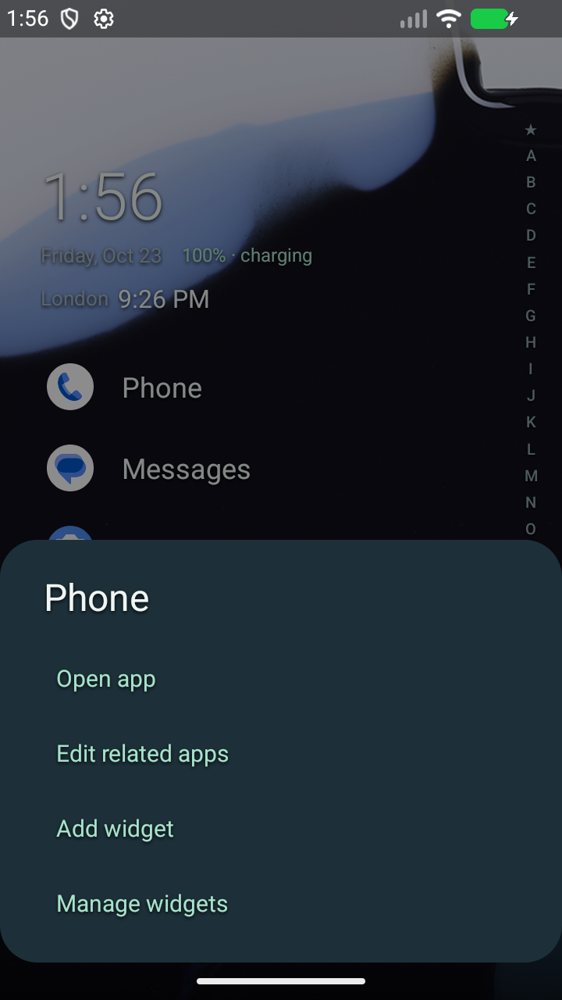

# A little launcher. A lot more room.

Rill puts your favorite apps within reach and lets your wallpaper do the talking. This tour shows real screens from the released APK, arranged in original presentation panels. Color icons are enabled for the main demo; grayscale remains an option and is the default.

## From home to any app

Favorites live on home. The alphabet rail takes you through installed apps, and search brings prefix matches first. Long press an app to rename, hide or reorder it.

## Make it yours

AMOLED black, transparent wallpaper, adjustable dimming and four built-in gradients. Choose original-color or grayscale icons, add a second clock and battery readout, and adjust text size or home spacing.

## More behind each app

Swipe right on an app to open its pop-up. Add related apps, host a widget, or use supported notification/media actions when optional notification access is enabled.

## All the details, when you want them

[Every setting with screenshots](SETTINGS-GALLERY.md) · [Features and gestures](FEATURES.md) · [Download APK](https://github.com/grigsmediagroup-hash/rill-launcher/releases/download/v0.1.0/Rill-0.1.0.apk)

The screens were captured on an isolated Android 16 emulator on 23 October 2026, not on the user's phone. Presentation frames and typography sit around the real captures; app UI is not fabricated. Third-party app icons, system wallpaper and provider content retain their owners' rights. See [validation limits](VALIDATION.md) for device coverage.
